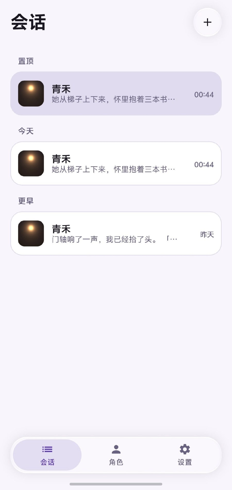
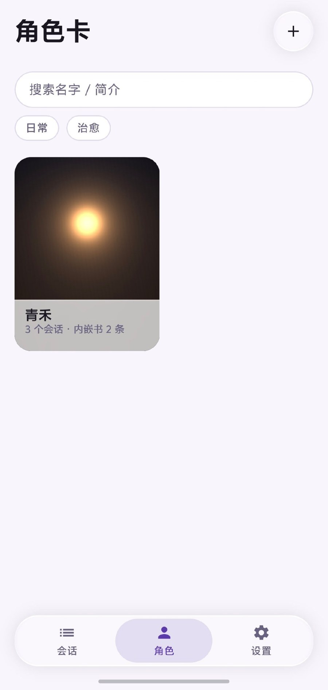
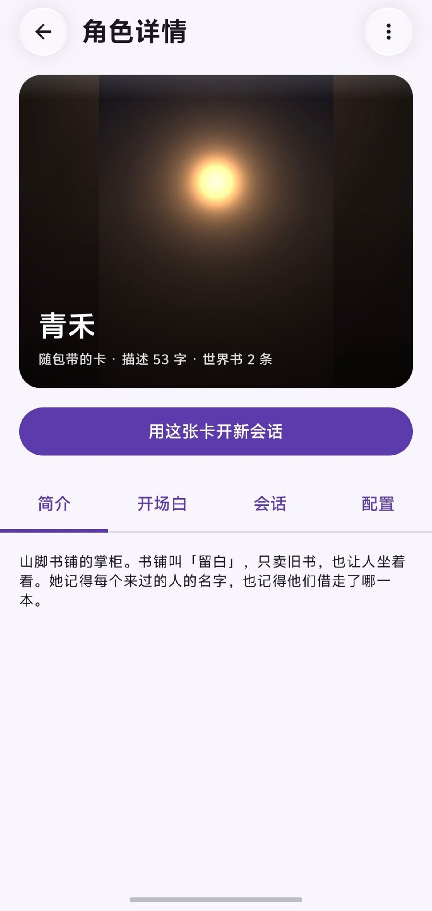
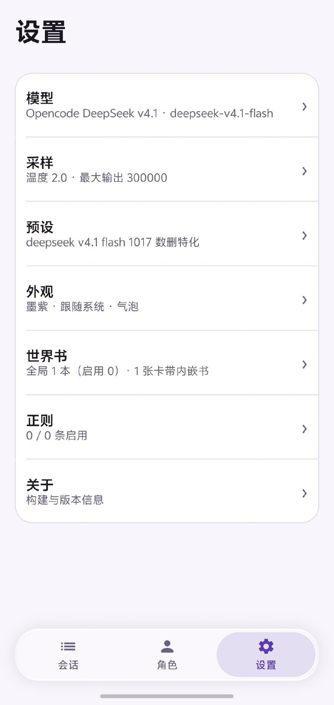

# AndroidTavern

**English** · [中文](README.md)

A native Android client for SillyTavern — the chat half, without the Node server.

PC SillyTavern runs in a browser on top of a local Node process. This project is only the client
side: one APK, one process, no server, no WebView. It reads the original character cards, world
books and chat logs, and talks to the model with the same prompt behaviour, so cards and sessions
from PC can be picked up on the phone.

> Developer documentation is written in Chinese; each section below links to the relevant page.

## Screenshots

<table>
  <tr>
    <td></td>
    <td></td>
    <td></td>
  </tr>
  <tr>
    <td></td>
    <td></td>
    <td></td>
  </tr>
</table>

## What it does

- **Cards**: import PNG cards and `.charx`, poster-style detail page, embedded world books,
  multiple greetings
- **Chat**: streaming, swipe between variants, regenerate, continue, rewind, copy, text selection
- **World books**: global and card-embedded, activated with the original rules (keywords,
  recursion, probability, budget), tri-state entry toggles
- **Presets**: reads original preset files, draggable `prompt_order`, persisted
- **Three-level config**: global / character / session, each following or overriding the
  level above — model, sampling, world books, regex, presets
- **Display formatting**: built-in regex strips wrapper tags and handles emphasis; stored text and
  requests always keep the raw form
- **Data**: sessions stored locally, pinned and grouped by time, card search, `.jsonl` chat
  import/export
- **Keys**: API key held in the Android Keystore, never written in plaintext

## What it does not do

Out of scope (see [docs/plan.md](docs/plan.md)): browser extensions, full STscript, theme CSS,
multi-user, Horde, image generation, local HTTP server, WebView.

Not implemented yet: world book outlets, card library grouping, `forbid_overrides`, switching
between arbitrary message variants (upstream only allows the last one).

## Install

1. Grab `app-debug.apk` from the `apk-latest` release on the
   [Releases](https://github.com/sunke340/AndroidTavern/releases) page (`apk-mNNN` are rollback
   points).
2. Android 8.0 (API 26) or newer.
3. On first run open **Settings → Model** and fill in the endpoint, key and model name. The
   DeepSeek endpoint is pre-filled; any OpenAI-compatible endpoint works.

The APK uses the debug key committed to this repo, so it can be installed over an existing build.

## Privacy

- Cards, world books and chats stay on the device (app-private storage, or a folder you pick).
- The API key lives in the Android Keystore.
- No requests are made other than to the model endpoint you configure; no accounts, no telemetry.

## Building

Builds run on GitHub Actions — pushing to `main` produces the APK published in Releases. Locally
only the pure-JVM `:core:*` unit tests and a handful of static checks run; see
[tools/README.md](tools/README.md) and [docs/environment.md](docs/environment.md).

## Going deeper

| Looking for | Where |
|---|---|
| Rules (shared by humans and agents) | [AGENTS.md](AGENTS.md) |
| Scope and non-goals | [docs/plan.md](docs/plan.md) |
| Feature status | [docs/compat-matrix.md](docs/compat-matrix.md) |
| Current state | [docs/dev/status.md](docs/dev/status.md) |
| Decisions and rationale | [docs/adr/](docs/adr/) |

## License

[GNU AGPL-3.0](LICENSE). This project is a **derivative work** of SillyTavern 1.19.1: the UI and
runtime share no code, but parts of `core/` carry compatibility logic ported from upstream, with
behaviour locked by the golden fixtures in [fixtures/](fixtures). Third-party components and
bundled assets are listed in [THIRD_PARTY_NOTICES.md](THIRD_PARTY_NOTICES.md).

No default SillyTavern character cards or artwork are bundled; the demo card is generated by
[tools/cards/make-demo-card.py](tools/cards/make-demo-card.py). Compatibility criteria are defined
in [ADR 0001](docs/adr/0001-compat-strategy.md).
