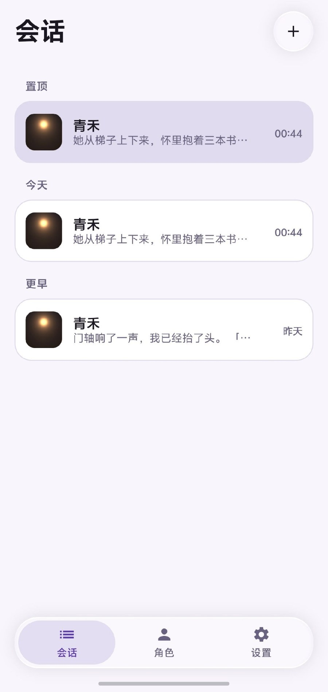
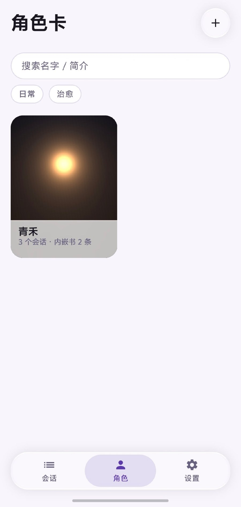
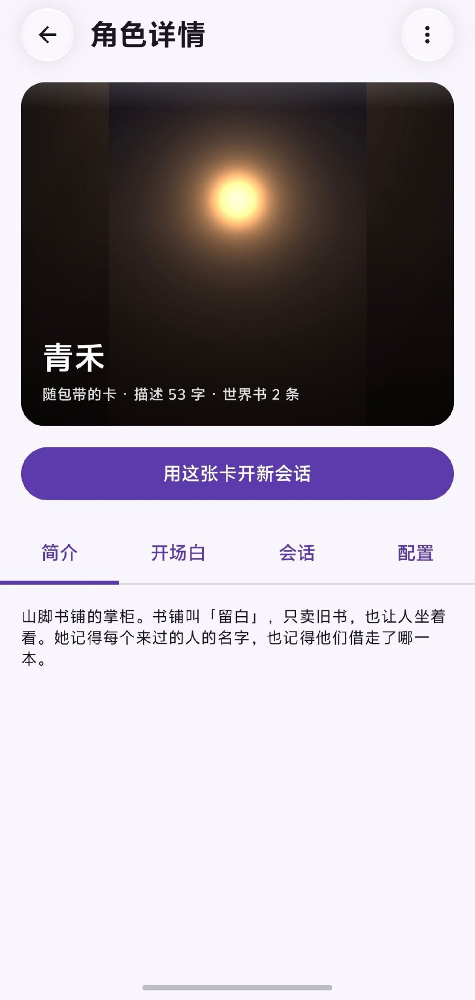
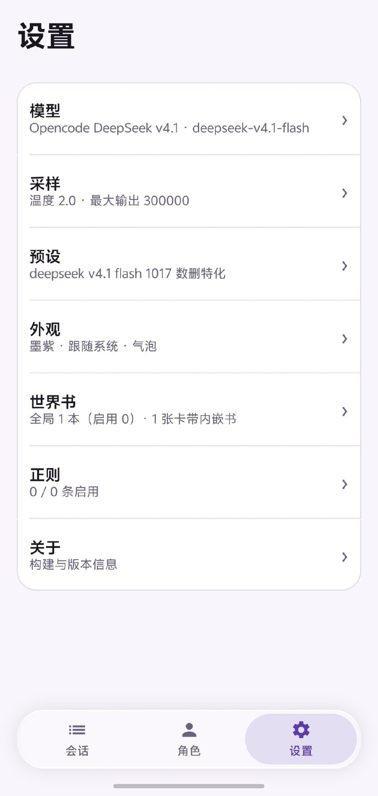

# AndroidTavern

[English](README.en.md) · **中文**

原生安卓版「酒馆」：把 SillyTavern 的**聊天**搬到手机上。

PC 版酒馆跑在浏览器里，身前挂着一个 Node 服务。这个项目只做客户端那一半 —— 单个 APK、
单进程、没有服务端、没有 WebView。它读原版的角色卡、世界书与聊天记录，按原版的提示词行为
发请求，所以 PC 上的卡和会话可以拿过来接着聊。

## 截图

<table>
  <tr>
    <td></td>
    <td></td>
    <td></td>
  </tr>
  <tr>
    <td></td>
    <td></td>
    <td></td>
  </tr>
</table>

## 能做什么

- **角色卡**：导入 PNG 卡与 `.charx`，海报式详情页，卡内嵌世界书与多条开场白
- **聊天**：流式输出、多版本翻页（swipe）、重新生成、继续、撤回、复制、长按选字
- **开场白**：在气泡下就地翻页切换，可在卡上设默认
- **世界书**：全局书与卡内嵌书，按原版规则激活（关键字、递归、概率、预算），条目三态开关
- **预设与提示词顺序**：读原版预设文件，`prompt_order` 可拖动改序并持久化
- **三级配置**：全局 / 角色卡 / 会话逐层跟随或覆盖 —— 模型、采样五项、世界书、正则、预设
- **消息显示格式**：内置正则清理包裹标签并处理强调，也可加自己的正则；存档与请求始终是原文
- **数据**：会话落库、置顶与按时间分组、角色卡搜索；聊天记录可导入导出 `.jsonl`
- **外观**：主题预设、跟随系统深浅色、气泡与卡片两种消息样式
- **密钥**：API Key 存进 Android Keystore，不落明文、不进日志

## 不做什么

不在范围内（口径见 [docs/plan.md](docs/plan.md)）：浏览器扩展体系、STscript 全量、主题 CSS、
多用户、Horde、图片生成、本地 HTTP 服务、WebView。

原版有、本项目还没做：群聊、作者注、用户人设、记忆与摘要、TTS、翻译、快捷回复、
世界书 outlet、卡库分组、`forbid_overrides`。

- 人设已排进需求批 F（多人设 + 三级覆盖，夹具先行）。
- 群聊 / 作者注 / TTS 在[兼容矩阵](docs/compat-matrix.md)里分别是 P2-1 / P1-7 / P2-3。
- 翻译与快捷回复在原版是两个内置扩展；本项目要做，得先给它们立条目。

## 安装

1. 到 [Releases](https://github.com/sunke340/AndroidTavern/releases) 取 `apk-latest` 里的
   `app-debug.apk`（每次推送自动构建；`apk-mNNN` 是历史回退点）。
2. 需要 Android 8.0（API 26）及以上。
3. 首次运行到 **设置 → 模型** 填接口地址、Key 与模型名。默认预填 DeepSeek 的地址，
   也可以换成任意兼容 OpenAI 协议的接口。

APK 用仓库内固定的 debug 签名，可以直接覆盖安装，不必先卸载。

## 隐私

- 角色卡、世界书、聊天记录只存在本机（应用私有目录，或你指定的 SAF 目录）。
- API Key 放在 Android Keystore，不以明文落盘。
- 除你配置的模型接口外，应用不发起其它网络请求；没有账号体系，没有遥测。

## 自己编

构建在 GitHub Actions 上完成（推到 `main` 即出包，产物进 Releases）。本机只跑得起纯 JVM 的
`:core:*` 单测与几项静态检查，命令见 [tools/README.md](tools/README.md)；为什么这台机器编不了
Android 模块，见 [docs/environment.md](docs/environment.md)。

## 想深入

| 想找 | 去哪 |
|---|---|
| 规则（人和 agent 共用一份） | [AGENTS.md](AGENTS.md) |
| 做什么、不做什么 | [docs/plan.md](docs/plan.md) |
| 每个特性做到什么程度 | [docs/compat-matrix.md](docs/compat-matrix.md) |
| 现在是什么状态 | [docs/dev/status.md](docs/dev/status.md) |
| 某个决定为什么这么定 | [docs/adr/](docs/adr/) |
| 界面元素的标准叫法 | [docs/ui-map.md](docs/ui-map.md) |

## 许可

[GNU AGPL-3.0](LICENSE)。本项目是 SillyTavern 1.19.1 的**衍生作品**：界面与运行时不共享代码，
但 `core/` 里有多处兼容逻辑移植自原版，行为由 [fixtures/](fixtures) 里的 golden 夹具锁定。
第三方组件与内置资产见 [THIRD_PARTY_NOTICES.md](THIRD_PARTY_NOTICES.md)。

仓库内不含 SillyTavern 的默认角色卡与图片；内置演示卡「青禾」由
[tools/cards/make-demo-card.py](tools/cards/make-demo-card.py) 生成。兼容性的验收标准见
[ADR 0001](docs/adr/0001-compat-strategy.md)。
